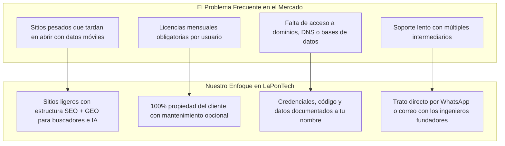

# 🎯 Clientes Objetivo y Análisis de Mercado — LaPonTech Solutions

Documento semántico que describe el enfoque comercial híbrido (**B2C para Comercios/PYMEs** y **B2B en Marca Blanca para Agencias**), los dolores cotidianos y los criterios de decisión de los clientes de **LaPon Tech Solutions**.

---

## 1. El Contexto Comercial en Honduras

La mayoría de los negocios y agencias en Honduras operan bajo estas realidades:
1. **Conexiones Móviles con Datos:** Los usuarios finales navegan principalmente desde teléfonos celulares usando datos móviles. Si una página está sobrecargada y tarda demasiado en abrir, el visitante la cierra antes de consultar.
2. **Cultura de Conversión por WhatsApp:** El comprador local prefiere ver productos o servicios claros, tocar un botón y conversar directamente por WhatsApp para cerrar su pedido o cotización.
3. **Cansancio de Suscripciones Forzosas y Cuellos de Botella Técnicos:** Los comercios buscan ser dueños de sus herramientas sin pagar rentas mensuales obligatorias por usuario, mientras que las agencias de marketing necesitan un respaldo de ingeniería confiable sin asumir costos fijos de planilla.

---

## 2. Segmentación Híbrida de Clientes

### Segmento A: Pequeños Comercios y Negocios en Crecimiento (PYMEs)
- **Sectores Típicos:**
  - Ferreterías, farmacias, tiendas de repuestos automotrices y talleres.
  - Bodegas de abarrotes, distribuidoras, restaurantes, cafeterías y tiendas con venta por redes sociales.
  - Clínicas médicas, laboratorios, despachos contables y servicios profesionales.
- **Problemas Frecuentes que Resolvemos:**
  - **Pérdida de clientes por no tener catálogo claro ni presencia en buscadores/IA:** Dependen solo de responder mensajes manuales en redes sociales y no aparecen cuando alguien busca sus servicios en Google o en inteligencias artificiales (ChatGPT, Gemini, Perplexity).
  - **Desorden operativo en cuadernos o Excel:** No tienen claridad inmediata de qué mercadería está por agotarse o qué facturas pendientes están por vencer.
  - **Tareas repetitivas manuales:** Pierden horas enviando confirmaciones o recordatorios de cobro uno por uno y copiando datos dos veces.
- **Lo que les Convence de LaPonTech:**
  - Páginas web rápidas pensadas para celulares y estructuradas con **SEO + GEO** para facilitar que Google y las IAs reconozcan su negocio.
  - Sistemas hechos exactamente a la medida de su flujo de trabajo.
  - **Propiedad del 100% y mantenimiento opcional:** Pagan por su desarrollo y deciden libremente si lo administran por su cuenta o contratan soporte opcional.

### Segmento B: Medianas Empresas en Expansión
- **Sectores Típicos:**
  - Distribuidoras con varias sucursales en el Valle de Sula, empresas de logística o firmas con 5 a 30 empleados.
- **Problemas Frecuentes que Resolvemos:**
  - **Licencias mensuales acumulativas (SaaS):** Proveedores que cobran mensualidades obligatorias por cada empleado conectado y suspenden el acceso si dejan de pagar.
  - **Falta de control sobre sus datos y dominios:** Dificultad para acceder a su propia base de datos o configurar sus correos corporativos para que no caigan en spam.
- **Lo que les Convence de LaPonTech:**
  - Control total sobre su base de datos, código y dominio `.com`.
  - Configuración profesional de DNS y correos corporativos (`SPF, DKIM, DMARC`) sobre proveedores externos especializados (Google Workspace, Microsoft 365, Zoho).

### Segmento C: Agencias de Marketing, Diseño y Publicidad (Modalidad Marca Blanca — B2B)
- **Perfil:** Directores o fundadores de agencias de marketing digital, estudios de diseño gráfico, agencias de publicidad y consultores de pauta.
- **Problemas Frecuentes que Resolvemos:**
  - **Cuellos de botella técnicos:** Tienen campañas publicitarias o diseños listos, pero carecen de un ingeniero interno para programar landings ultrarrápidas, configurar DNS/correos o conectar webhooks con WhatsApp/CRM.
  - **Costos fijos elevados:** No desean contratar programadores en planilla fija para proyectos puntuales.
  - **Temor a que el proveedor técnico compita con ellos:** Necesitan un socio técnico que respete al 100% su autoría comercial y su relación con el cliente final.
- **Lo que les Convence de LaPonTech:**
  - **Ejecución 100% en Marca Blanca:** Operamos detrás de escena con total discreción y respeto por sus clientes.
  - **Tarifas preferenciales para agencias y descuento introductorio** en los primeros encargos para maximizar su margen comercial con riesgo mínimo.

---

## 3. Problemas Frecuentes vs. Nuestro Enfoque

