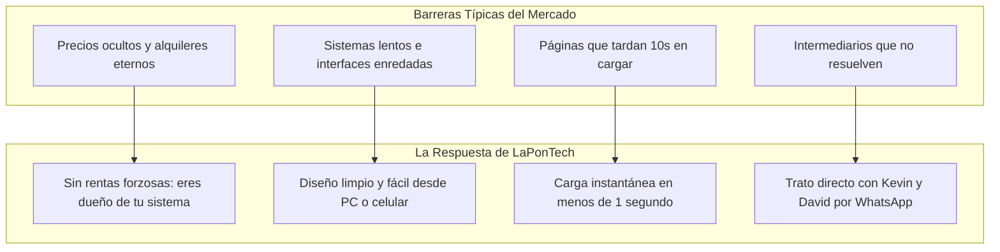

# 🎯 Clientes Objetivo y Análisis de Mercado — LaPonTech Solutions

Documento semántico que describe el perfil psicográfico, los dolores cotidianos, la realidad comercial y los criterios de compra de los clientes a los que sirve **LaPon Tech Solutions**.

---

## 1. El Contexto Comercial en Honduras

La mayoría de los negocios en Honduras operan bajo estas realidades:
1. **Conexiones Móviles Prepago:** Clientes finales y dueños navegan principalmente en sus teléfonos móviles usando datos celulares (paquetes Tigo/Claro). Si una página tarda más de 3 segundos en abrir, el usuario la cierra y se va a la competencia.
2. **Cultura de Compra por WhatsApp:** El hondureño promedio no compra rellenando carritos de compras complejos con pasarelas de pago que piden tarjeta de crédito; prefiere ver las fotos y precios, presionar un botón y consultar directamente a WhatsApp para acordar entrega o pago en efectivo/transferencia.
3. **Desconfianza por Malas Experiencias:** Muchos comerciantes han sido estafados por "agencias" que les cobraron caro por webs en WordPress que nunca funcionaron bien o por sistemas con cuotas mensuales sorpresa por cada usuario agregado.

---

## 2. Segmentación de Clientes

### Segmento A: Pequeños Comercios y Negocios Familiares (Foco Principal — 70%)
- **Sectores Típicos:**
  - Ferreterías de colonia y suministros de construcción.
  - Farmacias independientes y droguerías de barrio.
  - Venta de repuestos para autos y motocicletas.
  - Talleres mecánicos y de refrigeración.
  - Bodegas de abarrotes y distribuidoras de alimentos.
  - Restaurantes, cafeterías y negocios de comida rápida.
  - Tiendas de ropa, calzado o accesorios que venden por redes sociales.
- **Dolores Reales (Pain Points):**
  - **Inventario ciego:** No saben con certeza qué productos se están agotando hasta que el cliente llega a pedirlo y no hay.
  - **Cuentas por cobrar en cuadernos:** Anotan créditos ("fiados") en libretas que se pierden, se manchan o se rompen.
  - **Pérdida de ventas en WhatsApp:** El cliente pide precios por mensaje, el dueño tarda 2 horas en responder con fotos sueltas, y para cuando contesta, el cliente ya compró en otro lugar.
  - **Miedo al software tradicional:** Creen que para usar un sistema necesitan ser "expertos en computación" o comprar computadoras de última generación.
- **Lo que les Convence de LaPonTech:**
  - La herramienta se aprende a usar en 10 minutos.
  - Funciona rápido en la computadora que ya tienen o en el celular.
  - No pagan cuotas mensuales por usar su propio sistema.
  - El catálogo web permite al cliente elegir productos y mandar el pedido ordenado al WhatsApp del negocio.

### Segmento B: Medianas Empresas en Expansión (Foco Secundario — 30%)
- **Sectores Típicos:**
  - Distribuidoras locales con 2 o más sucursales en el Valle de Sula.
  - Clínicas médicas y laboratorios con varios consultorios.
  - Despachos contables o agencias de servicios con 5 a 30 empleados.
  - Empresas de transporte o talleres industriales.
- **Dolores Reales:**
  - **El alquiler del software (SaaS) se volvió insostenible:** El proveedor internacional les cobra \$50 a \$200 mensuales *por cada usuario*, sangrando el flujo de caja.
  - **Software secuestrado:** Si quieren cambiarse de programa, el proveedor anterior no les da acceso a la base de datos de sus clientes e histórico de ventas.
  - **Rigidez:** Las aplicaciones genéricas les obligan a cambiar su forma de trabajar porque no se pueden personalizar.
- **Lo que les Convence de LaPonTech:**
  - **Soberanía digital:** El código y la base de datos son 100% de la empresa, desplegados en su propia infraestructura.
  - Lógica adaptada a su flujo exacto de compras, inventario Kardex y autorización de pedidos.
  - Pólizas de mantenimiento y soporte opcionales y transparentes, nunca forzosas.

---

## 3. Barreras de Entrada que Rompe LaPonTech

