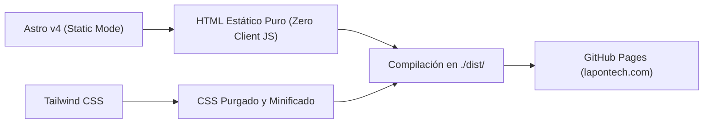

# 🛠️ Arquitectura Técnica, SEO y Despliegue — LaPonTech Solutions

Documento semántico que documenta las decisiones de ingeniería de software, estándares de rendimiento, configuración de metadatos (Open Graph / Twitter Cards) y pipeline de despliegue continuo de **LaPon Tech Solutions**.

---

## 1. Stack Tecnológico de la Landing Page

La web corporativa (`lapontech.com`) está construida bajo una estricta política de **rendimiento extremo y cero fricción**:



| Componente | Tecnología | Justificación Técnica |
| :--- | :--- | :--- |
| **Generador de Sitios** | [Astro v4](https://astro.build/) | Modo `output: "static"`. Genera páginas estáticas puras que no ejecutan JavaScript innecesario en el navegador del cliente. |
| **Framework de Estilos** | [Tailwind CSS](https://tailwindcss.com/) | Utilidades atómicas compiladas; genera un archivo CSS minificado ultraligero sin librerías externas de diseño. |
| **Iconografía** | SVGs Puros Inline | Iconos vectoriales integrados directamente en el marcado HTML sin librerías de iconos externas (`react-icons`, `font-awesome`, etc.) que agreguen peso. |
| **Alojamiento y CDN** | [GitHub Pages](https://pages.github.com/) | Infraestructura global con CDN distribuida Fastly/GitHub, costo \$0 de servidor para la landing, soporte HTTPS nativo y registro CNAME en `lapontech.com`. |

---

## 2. Pipeline de Despliegue Automático (CI/CD)

El despliegue se gestiona mediante GitHub Actions en el archivo [`.github/workflows/deploy.yml`](file:///home/kevin/Documentos/webs/LaPon%20solutions/.github/workflows/deploy.yml):

- **Disparador:** Cada `push` directo a la rama **`main`**.
- **Etapa 1: Build:**
  - Instala dependencias con `npm ci` o `npm install`.
  - Ejecuta `npm run build` utilizando la acción oficial `withastro/action@v3`.
  - Sube el directorio `dist/` como artefacto de GitHub Pages.
- **Etapa 2: Deploy:**
  - Despliega el artefacto en el entorno `github-pages` utilizando `actions/deploy-pages@v4`.
- **Dominio Personalizado:** Configurado mediante el archivo [`public/CNAME`](file:///home/kevin/Documentos/webs/LaPon%20solutions/public/CNAME) apuntando a `lapontech.com`.

---

## 3. Configuración de Open Graph, Redes Sociales y WhatsApp

Ubicación del componente central: [`src/components/SEO.astro`](file:///home/kevin/Documentos/webs/LaPon%20solutions/src/components/SEO.astro).

### Reglas Críticas para WhatsApp y Meta
1. **Formato Raster Obligatorio:** WhatsApp y Facebook **no admiten SVG** para la previsualización del enlace.
2. **Imagen Oficial:** [`public/logo-completo.png`](file:///home/kevin/Documentos/webs/LaPon%20solutions/public/logo-completo.png) y [`public/logo-completo.jpg`](file:///home/kevin/Documentos/webs/LaPon%20solutions/public/logo-completo.jpg):
   - **Dimensiones:** 1024 × 517 px (relación ~1.98:1 compatible con tarjetas horizontales grandes).
   - **Peso:** 171 KB (PNG) y 82 KB (JPG) (muy por debajo del límite de 300 KB recomendado por Meta para carga rápida en redes móviles).
   - **Fondo:** `#080e1d` (slate-950 institucional de la marca con isotipo esmeralda y texto completo "LaPon Tech Solutions").
3. **Etiquetas Requeridas en `<head>`:**
   ```html
   <meta property="og:site_name" content="LaPon Tech Solutions" />
   <meta property="og:type" content="website" />
   <meta property="og:url" content="https://lapontech.com/" />
   <meta property="og:title" content="LaPonTech | Páginas Web Rápidas y Software a Medida en San Pedro Sula" />
   <meta property="og:description" content="Creamos páginas web ultrarrápidas, catálogos digitales para WhatsApp y software a medida para tu negocio sin mensualidades forzosas en Honduras." />
   <meta property="og:image" content="https://lapontech.com/logo-completo.png" />
   <meta property="og:image:url" content="https://lapontech.com/logo-completo.png" />
   <meta property="og:image:secure_url" content="https://lapontech.com/logo-completo.png" />
   <meta property="og:image:type" content="image/png" />
   <meta property="og:image:width" content="1024" />
   <meta property="og:image:height" content="517" />
   <meta property="og:image:alt" content="LaPon Tech Solutions - Logotipo Oficial de la Empresa" />
   <link rel="image_src" href="https://lapontech.com/logo-completo.png" />
   ```
4. **Twitter Cards:**
   ```html
   <meta name="twitter:card" content="summary_large_image" />
   <meta name="twitter:image" content="https://lapontech.com/logo-completo.png" />
   ```
5. **Schema.org JSON-LD:**
   - Tipo `@type: ProfessionalService` con geolocalización en San Pedro Sula (`15.5042, -88.0250`), `postalCode: 21101`, datos de contacto oficial (`contacto@lapontech.com`) y listado de los fundadores Kevin D. Ponce y David Flores Lagos.

---

## 4. Estructura del Código Fuente

```text
/
├── .github/workflows/deploy.yml   # Workflow de CI/CD para GitHub Pages
├── docs/                          # Documentación segmentada del negocio y arquitectura
│   ├── 01-empresa-y-fundadores.md
│   ├── 02-clientes-objetivo-y-mercado.md
│   ├── 03-guia-de-tono-y-redaccion.md
│   ├── 04-portafolio-de-servicios.md
│   ├── 05-arquitectura-tecnica-y-seo.md
│   └── README.md
├── public/                        # Archivos estáticos directos
│   ├── CNAME                      # Dominio lapontech.com para GitHub Pages
│   ├── _headers                   # Encabezados de caché y seguridad HTTP
│   ├── logo-completo.png          # Imagen Open Graph oficial
│   ├── logo-completo.jpg          # Copia ultraligera para redes
│   └── icons/                     # Isotipos y logos vectoriales
├── src/
│   ├── components/
│   │   ├── Header.astro           # Barra de navegación superior
│   │   ├── Footer.astro           # Pie de página y canales de contacto
│   │   └── SEO.astro              # Generador de metadatos OpenGraph y Schema.org
│   ├── layouts/
│   │   └── Layout.astro           # Estructura HTML base y fondos ambientales
│   └── pages/
│       ├── index.astro            # Landing page principal (Bento Grid)
│       ├── servicios.astro        # Redirección canónica a /#servicios
│       └── 404.astro              # Página de error amigable
├── CONTEXT.md                     # Resumen unificado del contexto
└── README.md                      # Portada del repositorio en GitHub
```
