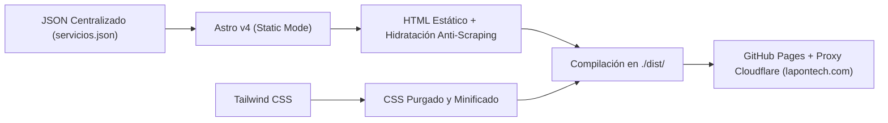

# 🛠️ Arquitectura Técnica, SEO, GEO y Despliegue — LaPonTech Solutions

Documento semántico que documenta las decisiones de ingeniería, optimización para buscadores tradicionales (**SEO**) y motores generativos de IA (**GEO**), seguridad anti-scraping y despliegue continuo de **LaPon Tech Solutions** (`lapontech.com`).

---

## 1. Stack Tecnológico de la Landing Page



| Componente | Tecnología | Justificación Técnica |
| :--- | :--- | :--- |
| **Generador de Sitios** | [Astro v4](https://astro.build/) | Modo `output: "static"`. Genera páginas estáticas ultraligeras ideales para conexiones de datos móviles en Honduras. |
| **Fuente de Datos Única** | [`src/json/servicios.json`](../src/json/servicios.json) | Centraliza textos, servicios, sección de agencias, comparativa, fundadores y FAQs para mantener coherencia entre la UI y el Schema.org. |
| **Framework de Estilos** | [Tailwind CSS](https://tailwindcss.com/) | Utilidades atómicas compiladas en un único CSS minificado sin librerías pesadas de terceros. |
| **Alojamiento y Red** | GitHub Pages + Cloudflare Proxy | Despliegue automático con GitHub Actions y protección de red mediante el proxy de Cloudflare en `lapontech.com`. |

---

## 2. Arquitectura SEO + GEO (Generative Engine Optimization)

### A. Triple Schema.org JSON-LD ([`src/components/SEO.astro`](../src/components/SEO.astro))
Para cumplir con los estándares de validación de Google y facilitar la extracción de entidades por modelos de IA, [`src/components/SEO.astro`](../src/components/SEO.astro) inyecta **3 bloques `<script type="application/ld+json">` independientes** (cada uno con un `@type` string de nivel superior):
1. **`ProfessionalService` (`#organization`):**
   - Incluye geolocalización en San Pedro Sula (`15.5042, -88.0250`), `postalCode: 21101`, `areaServed` (San Pedro Sula, Choloma, Villanueva, El Progreso, Puerto Cortés, La Lima, Tegucigalpa, Cortés, Honduras), `audience` (Comercios, PYMEs y Agencias de Marketing y Diseño), `knowsAbout`, `founder` (David Flores Lagos y Kevin D. Ponce) y `hasOfferCatalog`.
   - *Seguridad:* No expone `email` ni `telephone` en texto plano para evitar que bots recolectores de spam los extraigan del JSON-LD.
2. **`WebSite` (`#website`):**
   - Define la entidad del sitio en idioma `es-HN` vinculada a `#organization`.
3. **`WebPage` (`#webpage`):**
   - Incluye `SpeakableSpecification` apuntando a `["h1", "#servicios h2", "#comparativa h2", "#agencias h2", "#faq details"]` para asistentes de voz y motores de respuesta.
   - *Nota de cumplimiento Google (Agosto 2023):* No se utiliza `FAQPage` JSON-LD porque Google restringió ese tipo de resultado enriquecido exclusivamente a sitios gubernamentales y de salud.

### B. Archivo [`public/llms.txt`](../public/llms.txt) para Agentes de IA
Archivo en formato Markdown estructurado siguiendo el estándar `llms.txt` en la raíz del dominio (`https://lapontech.com/llms.txt`) para que **ChatGPT, Perplexity, Claude y Gemini** comprendan de inmediato:
- Identidad, ubicación y cobertura presencial/remota en Honduras.
- Los 4 servicios para PYMEs y la modalidad de **Marca Blanca para Agencias**.
- El correo oficial escrito de forma semántica anti-regex (`contacto [arroba] lapontech [punto] com`).

### C. Permisos Explícitos para Crawlers de IA en [`public/robots.txt`](../public/robots.txt)
Autoriza explícitamente la indexación a `GPTBot`, `OAI-SearchBot`, `ChatGPT-User`, `ClaudeBot`, `Claude-Web`, `anthropic-ai`, `PerplexityBot`, `Perplexity-User`, `Google-Extended` y `Applebot-Extended`, e indica la ruta del `Sitemap`.

---

## 3. Configuración de Open Graph, Redes Sociales y WhatsApp

1. **Imagen Oficial:** [`public/logo-completo.png`](../public/logo-completo.png) (`1024 × 517 px`, ~171 KB).
2. **Títulos y Descripciones Optimizados:**
   - **Title (60 caracteres):** `LaPonTech | Páginas Web, Sistemas a Medida y Marca Blanca`
   - **Description (156 caracteres):** `Páginas web rápidas, sistemas a medida sin rentas forzosas y brazo técnico en marca blanca para agencias en San Pedro Sula y Honduras. ¡Cotiza por WhatsApp!`

---

## 4. Estructura del Código Fuente

```text
/
├── .github/workflows/deploy.yml                 # Workflow de CI/CD para GitHub Pages
├── docs/                                        # Documentación estratégica y técnica segmentada
│   ├── 01-empresa-y-fundadores.md
│   ├── 02-clientes-objetivo-y-mercado.md
│   ├── 03-guia-de-tono-y-redaccion.md
│   ├── 04-portafolio-de-servicios.md
│   ├── 05-arquitectura-tecnica-y-seo.md
│   ├── 06-alianzas-y-marca-blanca-agencias.md   # Modelo B2B White-Label para agencias
│   ├── 07-seguridad-anti-scraping-y-geo.md      # Protección JS de correo/WhatsApp y WAF
│   └── README.md
├── public/
│   ├── CNAME                                    # Dominio lapontech.com
│   ├── _headers                                 # Encabezados de seguridad y caché
│   ├── llms.txt                                 # Contexto estructurado para motores de IA (GEO)
│   ├── robots.txt                               # Directivas para buscadores y crawlers de IA
│   ├── logo-completo.png                        # Imagen Open Graph oficial (1024x517)
│   └── icons/                                   # Isotipos vectoriales y PNG
├── src/
│   ├── components/
│   │   ├── Header.astro                         # Navegación con ancla a #agencias
│   │   ├── Footer.astro                         # Pie de página + script de hidratación de correo
│   │   └── SEO.astro                            # Metadatos OpenGraph + Triple Schema.org JSON-LD
│   ├── json/
│   │   └── servicios.json                       # Contenido centralizado de toda la landing
│   ├── layouts/
│   │   └── Layout.astro                         # Estructura HTML base (lang="es-HN")
│   └── pages/
│       ├── index.astro                          # Landing page principal + hidratación WhatsApp
│       ├── servicios.astro                      # Redirección limpia a /#servicios
│       └── 404.astro                            # Página 404 personalizada
├── CONTEXT.md                                   # Resumen maestro unificado del proyecto
└── README.md                                    # Documentación general del repositorio
```
