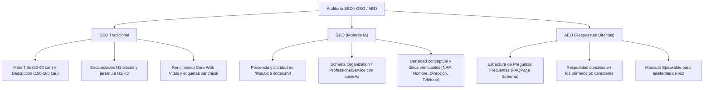
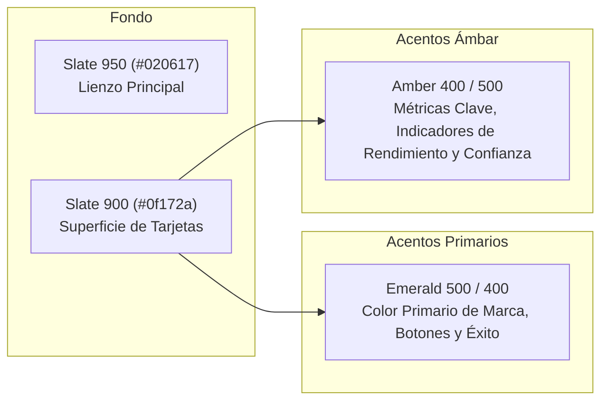

# 🛠️ 08. Skills y Herramientas del Agente — LaPon Tech Solutions

Este documento resume las **Skills de IA**, herramientas de auditoría, servidores MCP y hooks configurados en el proyecto para potenciar el desarrollo, diseño, rendimiento y posicionamiento en buscadores tradicionales y motores de inteligencia artificial.

---

## 🧭 Resumen de Skills Instaladas

Las skills residen en el directorio `.agents/skills/` y se activan automáticamente o por comando explícito cuando trabajas con el asistente:

| Skill | Ubicación | Propósito Principal | Cuándo se Activa |
|---|---|---|---|
| **`seo-geo-aeo`** | `.agents/skills/seo-geo-aeo/` | Auditoría integral de SEO tradicional, GEO (motores de IA) y AEO (respuestas directas y voz). | "audita mi web", "revisa el SEO", "¿por qué no posiciono?", "auditoría GEO/AEO". |
| **`apple-design`** | `.agents/skills/apple-design/` | Interfaces fluidas, respuesta física inmediata, resortes (*springs*), manipulación directa y latencia cero. | "diseño estilo Apple", "hazlo más fluido", "interacciones táctiles", "física de resortes". |
| **`impeccable`** | `.agents/skills/impeccable/` | Diseño frontend de alta gama, eliminación de vicios de IA (*AI-slop*), tipografía y jerarquía. | "rediseña", "haz un polish", "npx impeccable detect", "mejora el encabezado/CTA". |
| **`transitions-dev`** | `.agents/skills/transitions-dev/` | Catálogo de más de 35 micro-interacciones CSS portables y accesibles (`t-*`). | "añade una transición", "anima el modal", "scroll reveal", "skeleton loader". |
| **`transitions-polish`** | `.agents/skills/transitions-polish/` | Afinación fina de tiempos, curvas bézier y asimetrías de apertura/cierre. | "pule las transiciones", "ajusta el timing", "se siente tosco". |

Además, el entorno cuenta con:
- **MCP Server `transitions-agent`:** Conexión activa a `https://api.transitions.dev/v1/agent/mcp` para consulta y aplicación directa de recetas de animación.
- **Hook de calidad en `.agents/hooks.json`:** Inspección en tiempo real de antipatrones visuales ante escrituras o ediciones de código.

---

## 🔍 Guía 1: Cómo Auditar SEO, GEO y AEO con `seo-geo-aeo`

Esta skill evalúa la web en tres dimensiones cruciales para la era moderna:
1. **SEO (Search Engine Optimization):** Google, Bing, indexación técnica, metadatos, etiquetas Open Graph, estructura de encabezados y velocidad.
2. **GEO (Generative Engine Optimization):** Visibilidad, comprensión y citaciones dentro de motores generativos (ChatGPT Search, Perplexity, Gemini, Claude).
3. **AEO (Answer Engine Optimization):** Capacidad de la web para responder preguntas directas y alimentar fragmentos destacados (*featured snippets*) y asistentes de voz.

### Modos de Auditoría Disponibles
- **Quick Audit (1-2 minutos):** Analiza la página principal y las secciones de mayor señal (servicios, nosotros, contacto, JSON-LD) entregando puntajes inmediatos y prioridades críticas.
- **Full Audit (5-10 minutos):** Rastreo exhaustivo de páginas secundarias, sitemap, encabezados HTTP (`_headers`), `/llms.txt`, robots e informes descargables.

### Prompts de Ejemplo para Ejecutarla
Puedes solicitar la auditoría en cualquier momento usando frases como:
```markdown
# Auditoría rápida
"Haz una Quick Audit de SEO, GEO y AEO de lapontech.com"

# Auditoría profunda
"Realiza un Full Audit de SEO, GEO y AEO para lapontech.com y dime qué puntos clave faltan para aparecer en respuestas de Perplexity y ChatGPT"

# Auditoría técnica específica
"Verifica la estructura de Schema JSON-LD y la preparación para agentes en nuestro archivo public/index.md con la skill de SEO"
```

### Qué Revisa la Skill Durante la Auditoría


---

## 🎨 Guía 2: Diseño con Apple Design, Impeccable y la Paleta Ámbar / Esmeralda

La combinación de **`apple-design`** e **`impeccable`** garantiza que LaPon Tech mantenga una estética moderna, limpia y altamente profesional, evitando el aspecto genérico y saturado típico de las plantillas creadas por IA.

### 1. Principios de Apple Design en la Web
- **Respuesta inmediata (Cero Latencia):**
  Todo botón o tarjeta clickeable debe reaccionar en el evento `pointerdown` y no esperar al `click`.
  ```html
  <!-- Ejemplo de clase Tailwind usada en LaPonTech -->
  <a href="/#contacto" class="... transition-transform duration-150 active:scale-[0.98]">
  ```
- **Movimiento físico y no decorativo:**
  Las animaciones responden a la física real: aceleración suave, desaceleración natural y respeto estricto a usuarios con reducción de movimiento:
  ```css
  @media (prefers-reduced-motion: reduce) {
    *, ::before, ::after {
      animation-duration: 0.01ms !important;
      transition-duration: 0.01ms !important;
    }
  }
  ```
- **Interrumpibilidad:** Si un usuario abre o cierra un menú móvil, la interacción se puede cancelar o reanudar de inmediato sin bloqueos de interfaz.

### 2. Detección de Antipatrones de Diseño con Impeccable
Para auditar la calidad visual del código, puedes ejecutar en terminal:
```bash
# Escanear componentes y código fuente de Astro
npx impeccable detect src/

# Escanear el sitio compilado en HTML para validar contraste y elementos finales
npx impeccable detect dist/
```

**Reglas de oro aplicadas en el proyecto:**
- ❌ **Prohibido el *Gradient Text* artificial:** No utilizar `bg-clip-text text-transparent` con degradados púrpuras o cianes en títulos principales. Se usa tipografía en color sólido nítido (`text-white`, `text-emerald-400`).
- ❌ **Prohibidos los resplandores falsos (*dark-glow*):** En lugar de cajas con sombras de colores desenfocadas (`shadow-[0_0_25px_emerald]`), se emplean sombras de elevación física direccional (`shadow-elevation-sm`, `shadow-elevation-md`).
- ❌ **Prohibidos los *Kicker Pills* repetitivos:** No colocar pastillas o insignias innecesarias sobre cada título de sección; la jerarquía se establece mediante pesos de fuentes y espacios en blanco.
- ❌ **Prohibidas las fuentes genéricas de IA:** Se utiliza **Outfit** (con personalidad técnica y geométrica) en lugar de fuentes genéricas saturadas.

### 3. Uso Correcto de la Paleta Ámbar (`amber`) y Esmeralda (`emerald`)
El sistema de diseño de LaPon Tech utiliza un fondo oscuro Slate (`#020617` / `#0f172a`) con dos acentos cromáticos estratégicos:



- **Color Esmeralda (`emerald`):**
  - Botones de acción principales (CTA: WhatsApp, cotizaciones).
  - Títulos secundarios y acentos de servicios.
  - Indicadores de estado completado o activo.
- **Color Ámbar (`amber`):**
  - **Métricas de alto impacto en el Hero:** Las cifras destacadas (`100%`, `Ágil`, `Directo`, `99.9%`).
  - **Insignias de rendimiento:** Garantía de código optimizado y optimización de velocidad.
  - **Regla de contraste:** El texto en ámbar debe utilizarse sobre fondo oscuro con al menos `text-amber-400` y fondos con transparencia controlada `bg-amber-500/10 border-amber-500/20` para mantener siempre un ratio de contraste accesible superior a 4.5:1.

---

## ⚡ Guía 3: Micro-Interacciones con `transitions-dev`

Cuando requieras crear o afinar componentes con animaciones avanzadas:

### 1. Consultar el Catálogo de Transiciones
Puedes pedirle directamente al asistente:
```markdown
"Muestra qué transiciones tenemos disponibles para un acordeón de preguntas frecuentes"
"Aplica la transición de 'Card hover tilt' a las tarjetas de servicios de la landing"
"Revisa las transiciones del menú con transitions-polish para ajustar los tiempos de entrada y salida"
```

### 2. Uso del Servidor MCP Transitions
El MCP `transitions-agent` permite extraer recetas exactas sin escribir CSS desde cero:
- `list_recipes`: Consulta las más de 35 recetas portables.
- `get_recipe`: Obtiene el código HTML/CSS listo para insertar en Astro con soporte `prefers-reduced-motion` incorporado.

---

## 📋 Comandos Rápidos de Referencia

| Acción | Comando / Instrucción |
|---|---|
| **Auditar SEO y GEO** | *"Haz una auditoría rápida de SEO y GEO de nuestro sitio"* |
| **Detectar antipatrones de diseño** | `npx impeccable detect src/` |
| **Construir y verificar HTML** | `npm run build && npx impeccable detect dist/` |
| **Probar Markdown para agentes** | `curl -I -H "Accept: text/markdown" https://lapontech.com/` |
| **Verificar headers HTTP** | `curl -I https://lapontech.com/` *(verifica cabeceras Link y Vary)* |
| **Puntaje de transiciones** | *"Pule las transiciones del header con transitions-polish"* |
