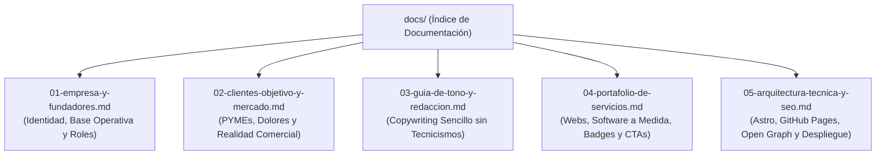

# 📚 Índice de Documentación — LaPonTech Solutions

Bienvenido al centro de documentación y contexto estratégico de **LaPon Tech Solutions** ([lapontech.com](https://lapontech.com)). Esta carpeta contiene todos los documentos segmentados con nombres semánticos para que cualquier miembro del equipo, colaborador o asistente de IA encuentre información específica de inmediato.

---

## 🗺️ Mapa de Documentos

---

## 📑 Resumen de Cada Documento

### 1. [01-empresa-y-fundadores.md](./01-empresa-y-fundadores.md)
- **Qué encontrarás:** Razón social, dominio, correo oficial, cobertura territorial (San Pedro Sula, Valle de Sula y nivel nacional) y los roles específicos de los fundadores **Kevin D. Ponce** (Sistemas, Bases de Datos, Infraestructura) y **David Flores Lagos** (Soporte, Atención al Cliente, Diseño Web).
- **Cuándo consultarlo:** Para verificar datos de contacto, atribuciones de roles o información sobre la base operativa.

### 2. [02-clientes-objetivo-y-mercado.md](./02-clientes-objetivo-y-mercado.md)
- **Qué encontrarás:** El perfil detallado de nuestros clientes (ferreterías, farmacias, bodegas, repuestos, talleres, medianas empresas), sus dolores reales (libretas, Excel desordenado, lentitud en WhatsApp, cobros mensuales abusivos de software) y cómo compran en Honduras.
- **Cuándo consultarlo:** Al idear nuevas propuestas comerciales, redactar anuncios o preparar reuniones con clientes.

### 3. [03-guia-de-tono-y-redaccion.md](./03-guia-de-tono-y-redaccion.md)
- **Qué encontrarás:** La regla de oro de comunicación: lenguaje directo y **cero tecnicismos innecesarios**. Incluye la tabla de equivalencias de qué términos usar y cuáles evitar rotundamente.
- **Cuándo consultarlo:** Antes de publicar cualquier texto en la landing page, banners, mensajes de WhatsApp o presupuestos.

### 4. [04-portafolio-de-servicios.md](./04-portafolio-de-servicios.md)
- **Qué encontrarás:** La ficha técnica y comercial completa de los 4 servicios oficiales:
  1. *Páginas Web Profesionales & Catálogos Digitales* (Entrega ≤ 1 semana).
  2. *Desarrollo de Software & Sistemas a Medida* (Entrega 1 a 3 meses).
  3. *Automatización de Procesos & WhatsApp para Negocios*.
  4. *Asesoría Tecnológica Integral*.
- **Cuándo consultarlo:** Para redactar las tarjetas de servicios, presupuestos o definir tiempos de entrega oficiales.

### 5. [05-arquitectura-tecnica-y-seo.md](./05-arquitectura-tecnica-y-seo.md)
- **Qué encontrarás:** El stack de alto rendimiento (Astro + Tailwind CSS), pipeline de GitHub Actions (`deploy.yml`), configuración de Open Graph/Twitter Cards para WhatsApp (`logo-completo.png`), Schema.org y estructura del proyecto.
- **Cuándo consultarlo:** Al realizar cambios de código, optimizaciones de velocidad o ajustes en el despliegue a producción.
