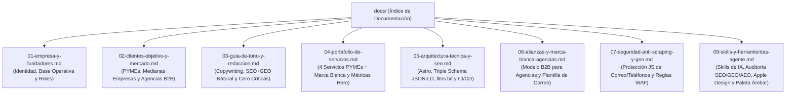

# 📚 Índice de Documentación — LaPonTech Solutions

Bienvenido al centro de documentación y contexto estratégico de **LaPon Tech Solutions** ([lapontech.com](https://lapontech.com)). Esta carpeta contiene todos los documentos segmentados con nombres semánticos para que cualquier miembro del equipo, colaborador o asistente de IA encuentre información específica de inmediato.

---

## 🗺️ Mapa de Documentos

---

## 📑 Resumen de Cada Documento

### 1. [01-empresa-y-fundadores.md](./01-empresa-y-fundadores.md)
- **Qué encontrarás:** Razón social, dominio, correo oficial protegido, cobertura territorial (San Pedro Sula, Valle de Sula y nivel nacional), modelo de mantenimiento 100% opcional y los roles de los fundadores **Kevin D. Ponce** (Director Técnico, Sistemas, Infraestructura, Alianzas con Agencias) y **David Flores Lagos** (Co-Fundador, Diseño Web Mobile-First, Atención al Cliente y Soporte).

### 2. [02-clientes-objetivo-y-mercado.md](./02-clientes-objetivo-y-mercado.md)
- **Qué encontrarás:** La segmentación híbrida en 3 perfiles:
  - **Segmento A:** Pequeños comercios y negocios familiares.
  - **Segmento B:** Medianas empresas en expansión.
  - **Segmento C:** Agencias de marketing, diseño y publicidad (servicio técnico en Marca Blanca).

### 3. [03-guia-de-tono-y-redaccion.md](./03-guia-de-tono-y-redaccion.md)
- **Qué encontrarás:** Los 6 principios de redacción: exponer problemas frecuentes sin atacar a consultoras/agencias, explicar el SEO y GEO con naturalidad sin prometer resultados garantizados, evitar promesas rígidas de tiempos, aclarar que los listados son ejemplos adaptables, destacar la configuración de DNS/correos sobre proveedores externos especializados, y no mencionar los nombres de los fundadores fuera de contexto antes de la sección `#nosotros`.

### 4. [04-portafolio-de-servicios.md](./04-portafolio-de-servicios.md)
- **Qué encontrarás:** Las 4 tarjetas del Hero (`Velocidad`, `100%`, `Ágil`, `Directo`), los 4 servicios para negocios y la línea B2B de Marca Blanca sincronizados con `src/json/servicios.json`.

### 5. [05-arquitectura-tecnica-y-seo.md](./05-arquitectura-tecnica-y-seo.md)
- **Qué encontrarás:** El stack de Astro v4 + Tailwind CSS, el esquema triple de Schema.org (`ProfessionalService`, `WebSite`, `WebPage` con `SpeakableSpecification`), el archivo `/llms.txt`, permisos para crawlers de IA en `robots.txt` y pipeline de despliegue.

### 6. [06-alianzas-y-marca-blanca-agencias.md](./06-alianzas-y-marca-blanca-agencias.md)
- **Qué encontrarás:** El modelo comercial y técnico de Marca Blanca para agencias, las 3 áreas de ejecución, el compromiso de respeto por el cliente de la agencia, el descuento introductorio de apertura y la plantilla oficial de correo comercial B2B.

### 7. [07-seguridad-anti-scraping-y-geo.md](./07-seguridad-anti-scraping-y-geo.md)
- **Qué encontrarás:** La arquitectura de ofuscación con JavaScript para proteger `contacto@lapontech.com` y los números de WhatsApp (`wa.me`) contra recolectores automáticos de spam sin perder visibilidad ante modelos de IA, los comandos `curl + grep` de auditoría en Linux y la regla personalizada de Cloudflare WAF.

### 8. [08-skills-y-herramientas-agente.md](./08-skills-y-herramientas-agente.md)
- **Qué encontrarás:** El compendio operativo de las skills instaladas (`seo-geo-aeo`, `apple-design`, `impeccable`, `transitions-dev`, `transitions-polish`), guías paso a paso para auditar SEO tradicional, GEO para motores de IA (ChatGPT, Perplexity, Gemini) y AEO, los principios de latencia cero de Apple, la eliminación de antipatrones visuales con `npx impeccable detect`, y el uso armónico de la paleta Ámbar y Esmeralda sin degradar el contraste ni generar halos artificiales.
